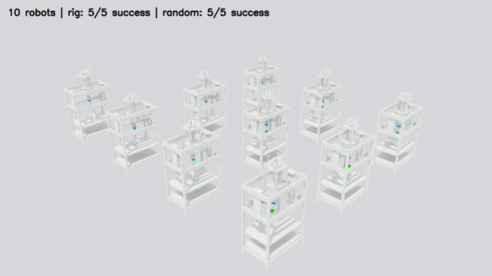
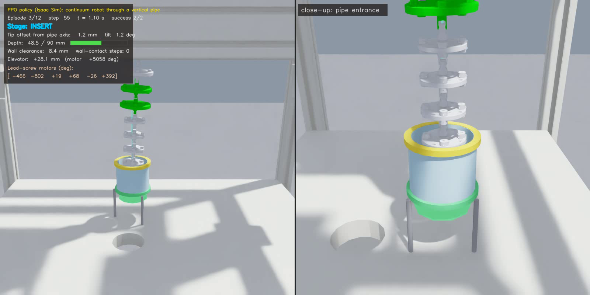
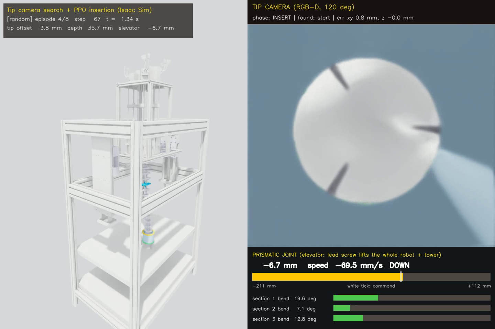
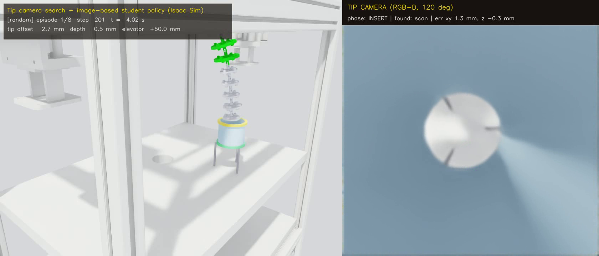
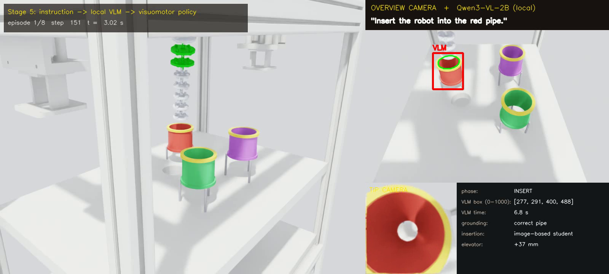
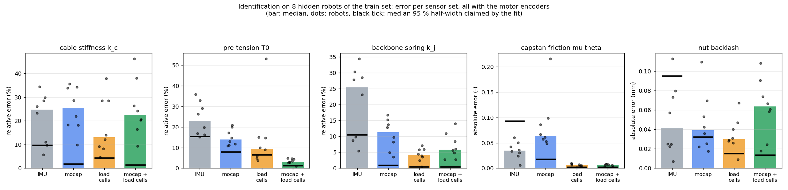
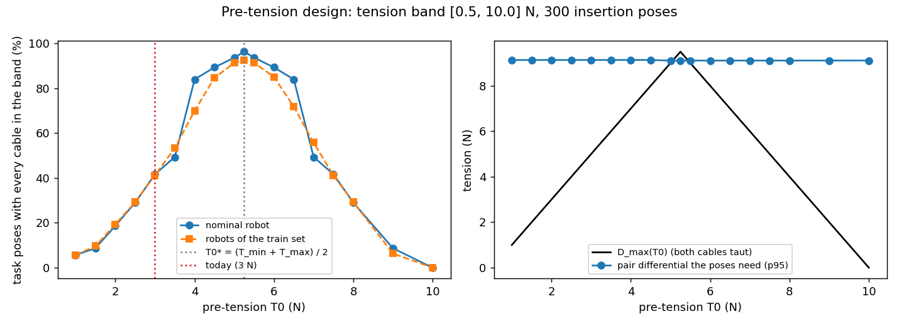
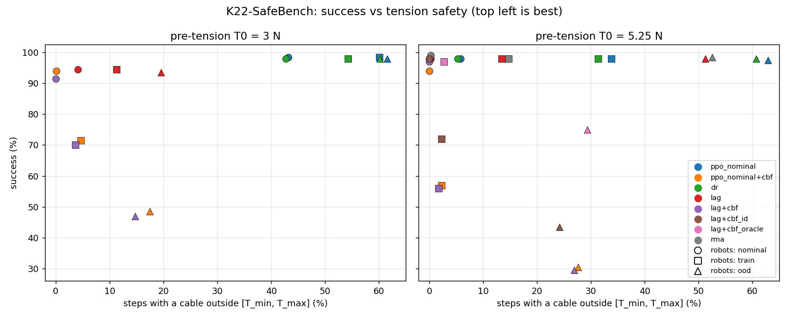
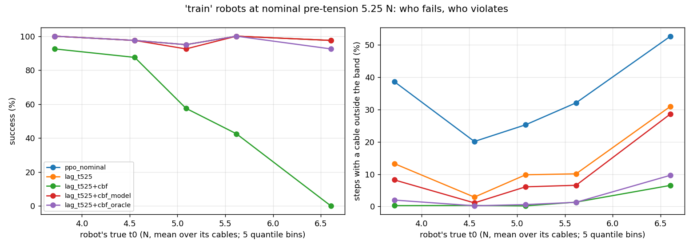

# Vertical-pipe task in Isaac Lab (port of the MuJoCo version)

Port of `D:\mujoco\Continuum_MuJoCo\task_vertical_pipe` (continuum robot bends into an S-shape
and feeds down through a vertical pipe) to Isaac Sim 5.1 / Isaac Lab 2.3.2, trained with rsl_rl.
Observation, action, reward, termination, reset / randomization, `dt` and `frame_skip` are the
ones of the MuJoCo env; the PPO update and hyperparameters are the ones of its SB3 trainer.





Videos (policy trained in MuJoCo, run in Isaac Sim): [12 random pipes, two-panel view](media/isaac_vertical_pipe_random_wide.mp4)
(12/12 success) and [10 robots at once](media/isaac_10_robots.mp4) (20/20 success).

| file | content |
|---|---|
| `constants.py` | task constants, copied 1:1 from `vertical_pipe_env.py` / `continuum_algorithm.py` |
| `kinematics.py` | MJCF kinematic tree + forward kinematics identical to `mj_kinematics` (numpy) |
| `reset_logic.py` | start-state sampling (`reset`, `_place_pipe`, `_assisted_start`), same numpy draws |
| `mdp.py` | action -> commands, measurements, observation (33), reward, termination (torch) |
| `vertical_pipe_env.py` | Isaac Lab `DirectRLEnv` + scene / sim configuration |
| `convert_mjcf_to_usd.py` | MJCF -> USD (robot) and the pipe USDs |
| `ppo_sb3.py`, `agent_cfg.py`, `pipe_runner.py` | rsl_rl PPO with the SB3 update rule, config, runner with eval / checkpoints |
| `train_vertical_pipe.py`, `play_vertical_pipe.py` | training / viewer, statistics, video |
| `import_sb3_policy.py` | SB3 model of the MuJoCo trainer (`.zip`) -> rsl_rl checkpoint (same networks) |
| `record_video.py` | two-panel MP4 (fixed wide view + close-up of the pipe entrance, HUD, guides) like the MuJoCo demo |
| `vision_env.py` | the env + an RGB-D camera on the tip (Seg15); the policy can see the camera's pipe estimate instead of the true pose |
| `perception.py` | pipe-mouth detector: yellow collar mask + depth -> 3D points -> circle fit (centre, height, quality) |
| `vision_pipeline.py` | look / lift / conical scan with the tip camera, return to the start pose, then the RL policy inserts |
| `play_vision.py` | statistics (vision vs true pose, sensor noise, `--student`) and MP4 with the tip-camera view |
| `preinsert.py`, `student_env.py` | pre-insertion hand-over poses (pipe in view) and the student's training starts |
| `student_policy.py`, `train_student.py` | image-based student (CNN on the tip RGB-D image + joint commands) and its DAgger training |
| `multi_pipe.py`, `multi_pipe_env.py` | Stage 5 scenes: 3 pipes of different tube colours, an instruction, an overview camera |
| `vlm.py` | local VLM (Qwen3-VL-2B, optional 4B): instruction + overview image -> box; HTTP server / client |
| `command_panel.py` | RICLAB command window for `play_language.py --ui` |
| `language_pipeline.py`, `play_language.py` | instruction -> VLM -> pipe -> pre-insertion pose -> image-based student; statistics / MP4 |
| `make_grounding_set.py`, `eval_grounding.py` | grounding benchmark: rendered scenes with ground truth, VLM accuracy without Isaac Sim |
| `make_showcase_video.py` | 1080p project video: title cards + MuJoCo / tip-camera / student / language clips + results |
| `uncertainty.py`, `uncertain_cables.py`, `robust_env.py` | Stage 6: uncertainty set, cable drive with capstan friction / backlash / payload per env, the env with safety costs |
| `sysid_experiments.py`, `sysid.py`, `plot_sysid.py` | Stage 6: identification experiments on hidden robots, output-error fit per sensor set |
| `pretension_study.py`, `safety_filter.py` | Stage 6: pre-tension design, robust CBF filter on the 12 cable tensions |
| `ppo_lag.py`, `rma.py`, `train_rma.py`, `controllers.py` | Stage 6: PPO-Lagrangian, RMA adaptation module, loading any controller |
| `shape_control.py`, `play_shape.py` | Stage 6: model-based shape control (lab formula, inverse statics, PI, adaptive) |
| `benchmark_safety.py`, `plot_safebench.py` | Stage 6: K22-SafeBench (controllers x uncertainty x stress), tables and figures |
| `record_safety_video.py`, `robust_stages.py` | Stage 6: clips with the tension band monitor; the Stage 4 / 5 envs on uncertain robots with the filter |
| `scripts/stage6_*.sh`, `docs/stage6_theory.md` | Stage 6: training / benchmark / demo queues; derivations |
| `tests/compare_with_mujoco.py` | checks against the MuJoCo env (runs in the MuJoCo venv) |
| `tests/check_isaac_env.py` | checks of the Isaac env, replay of MuJoCo trajectories in PhysX |
| `tests/check_robust_env.py`, `tests/check_safety_filter.py` | Stage 6: the uncertain twin against the nominal model / PhysX statics; the CBF QP against OSQP |
| `assets/mjcf/ContinuumRobot_Native.xml` | source MJCF (copy of `urdf/ContinuumRobot_Native.xml`) |

## Run

```cmd
cd D:\Continuum-Robot-Riclab-\task_vertical_pipe_isaaclab
set ISAAC=D:\Isaacsim\env_isaacsim62\Scripts\python.exe

:: 0. (optional) engine-independent parts vs the MuJoCo env, writes tests/data/mujoco_reference.npz
D:\mujoco\Continuum_MuJoCo\.venv\Scripts\python.exe tests\compare_with_mujoco.py

:: 1. MJCF -> USD (assets/generated/, not in git). --mesh-dir: folder with the .obj meshes
%ISAAC% convert_mjcf_to_usd.py --mesh-dir D:\mujoco\Continuum_MuJoCo\urdf

:: 2. checks in Isaac Sim (kinematics, resets, replay of the MuJoCo episodes, random actions)
%ISAAC% tests\check_isaac_env.py

:: 3. train (3M steps, 16 envs, rig + random scenes; same options as the MuJoCo trainer)
%ISAAC% train_vertical_pipe.py
%ISAAC% train_vertical_pipe.py --pipe-mode rig --timesteps 1000000
%ISAAC% train_vertical_pipe.py --resume models\ppo_vpipe\best_model.pt --contact-penalty 0.5 --run-name ppo_vpipe_ft
%ISAAC% train_vertical_pipe.py --n-envs 12 --stop-at 200000 :: short run, lr schedule still over 3M steps
tensorboard --logdir logs

:: 4. watch / evaluate
%ISAAC% play_vertical_pipe.py                               :: Isaac Sim window, rig then random pipe
%ISAAC% play_vertical_pipe.py --num_envs 10                 :: 10 robots at once (even: rig, odd: random)
%ISAAC% play_vertical_pipe.py --headless --episodes 100     :: success statistics
%ISAAC% play_vertical_pipe.py --video --episodes 5          :: MP4 with HUD in videos\
%ISAAC% record_video.py                                     :: two-panel MP4 like the MuJoCo demo --fixed-camera
                                                            :: (12 random pipes, same scenes as the MuJoCo video)

:: the policy trained in MuJoCo, in Isaac Sim (or as a start for --resume)
%ISAAC% import_sb3_policy.py D:\mujoco\Continuum_MuJoCo\task_vertical_pipe\models\ppo_vpipe_wide\final_model.zip models\mujoco_ppo_vpipe_wide\model.pt
%ISAAC% play_vertical_pipe.py --checkpoint models\mujoco_ppo_vpipe_wide\model.pt
```

All scripts append `--/app/vulkan=false` (DirectX 12, as the other Isaac scripts on this machine)
and import torch / tensordict / rsl_rl before Kit starts (Windows DLL order).

`env_isaacsim62` is Isaac Sim 6.2 + Isaac Lab 3 (Python 3.12). Differences to the former Isaac Lab 2
environment that the scripts handle:
- there are no `--headless` / `--enable_cameras` launcher flags: `app_launch.launcher_args()` sets them, and
  the Isaac Sim window is a Kit visualizer (`vertical_pipe_env.scene_view_cfg`, `set_scene_view`), which also
  gives the video frames (`scene_frame`; `env.render()` returns no image any more). `play_vertical_pipe.py`
  keeps its own `--headless` (statistics);
- its OpenCV has no video I/O: MP4s are written / read through imageio-ffmpeg (`video_io.py`), so install it
  once: `D:\Isaacsim\env_isaacsim62\Scripts\python.exe -m pip install imageio-ffmpeg`;
- Isaac Sim 6.2 and the VLM do not fit together in the 8 GB GPU (CUDA error 719 in the renderer):
  `play_language.py` loads the VLM on the CPU by default (`--vlm-device cuda` to override);
- quaternions are (x, y, z, w), asset data is read with `.torch`, writes use the `*_index` methods.

## What is the same as MuJoCo

| | MuJoCo (`task_vertical_pipe`) | Isaac Lab |
|---|---|---|
| timestep / frame_skip | `opt.timestep` 0.002 s, `N_SUBSTEPS` 10 | `sim.dt` 0.002 s, `decimation` 10 (20 ms, 50 Hz) |
| episode | 400 steps, truncation | `max_episode_steps` 400 (`episode_length_s` 8 s), `time_outs` |
| action (7) | bend-vector rates of 3 sections + elevator rate | `mdp.update_commands` (same rates, clipping, THETA_MAX) |
| observation (33) | `_get_obs` | `mdp.observation` (same terms, order and scaling) |
| reward | potential progress, time, wall contact, smoothness, +100 / -30 | `mdp.step_reward` |
| termination | success / unstable / rim_hit / missed_pipe | `mdp.outcome` |
| reset | pipe placement, assisted starts (40 % in training), 50 attempts | `reset_logic.py`; env i uses `default_rng(seed + i)` like SB3's seeding |
| scenes | `--pipe-mode mixed`: even envs rig, odd envs random | `pipe_modes=("rig", "random")`, same split |
| parallel envs | 16 (`SubprocVecEnv`, code default; the model in the task README was trained with 12) | 16 (`--n-envs`) |
| physics | gravity 0, servos kp 100 / kv 2 (elevator 3e4 / 1.2e3), armature 0.01, damping 0.5, force limit 20 N m, friction 0.3 | same values on PhysX implicit drives / materials |

Checked (`tests/`):
- the MJCF given to the importer compiles in MuJoCo to the model the MuJoCo env simulates (masses,
  joints, actuators, colliders; 300 steps with random controls differ by 3e-17);
- `kinematics.py` vs `mj_kinematics`: 1e-15 m; PhysX link poses of the USD vs `kinematics.py`: 0.005 mm;
- 3600 resets (1661 assisted) sampled like MuJoCo for the same seeds: identical (1e-15);
- `mdp.py` fed with MuJoCo states over 6075 steps (all outcomes, 937 wall-contact steps):
  observations bit-identical, rewards within 7e-15, no episode-end mismatch;
- replay of 72 MuJoCo episodes (same start state and actions) in PhysX: tip position differs by
  0.48 mm on average (95 %: 0.80 mm), reward by < 0.014 on 95 % of the steps, wall-contact steps
  agree on 900 of 905, the episode outcome is the same in 67/72 episodes (the others: 3 failures of
  another kind a few steps earlier - the tip passes within 1 mm of the rim - and 2 long random-action
  episodes that diverge after ~100 steps of wall contact). All observation terms agree (95 %: body
  positions < 0.7 mm, commands / pipe offset / previous action exact) except the contact count
  (`min(n, 4) / 4`), where the two engines produce different numbers of points per touch (mean
  difference 0.8 contacts);
- the policy trained in MuJoCo (`ppo_vpipe_wide/final_model.zip`, via `import_sb3_policy.py`) run in
  Isaac Sim (`play_vertical_pipe.py --headless --episodes 100 --seed 9000`):

  | scene | Isaac Sim | MuJoCo (task README) |
  |---|---|---|
  | rig | 99 % success (1 rim hit), 2.39 s, clearance median 4.0 mm, 100 % without wall contact | 100 %, 2.4 s, 4.0 mm, 100 % |
  | random 0-17 cm | 99 % (1 rim hit), 1.86 s, clearance median 5.9 mm, 81 % without wall contact | 99 % (1 rim hit), 83 % |

## MJCF -> USD

`convert_mjcf_to_usd.py` rebuilds the model the MuJoCo env simulates (the env edits the MJCF in code:
it removes the mesh colliders, adds one collision cylinder per segment, 31 position servos, armature
and damping), converts it with the Isaac Sim MJCF importer (`isaaclab.sim.converters.MjcfConverter`)
into `continuum_physics.usd` (colliders only, for training) and `continuum_visual.usd` (+ CAD meshes),
and writes `pipe_rig.usd` / `pipe_random.usd` (24 box staves on a kinematic body, bore 100 / 70 mm).

What the importer does not carry over, and the replacement:

| MuJoCo | Isaac Sim / Isaac Lab |
|---|---|
| tendons, equality constraints, `cable` / `flexcomp` plugins | none in this model (the continuum body is already a chain of 15 rigid universal joints, joint angle = section bend / 5). For other models: fixed tendons -> PhysX fixed tendons (the importer converts them), `equality joint` -> PhysX tendon / mimic joint, `weld` / `connect` -> fixed / spherical joint, cable / flexcomp -> chain of rigid capsules with drives, or a PhysX deformable body |
| `<option>` (timestep, gravity 0, implicitfast, Newton, pyramidal cone) | `SimulationCfg(dt=0.002, gravity=0)`, PhysX TGS, 8 position / 1 velocity iterations; drives are implicit like implicitfast |
| position servo `kv` (dropped by the importer) and joint damping | `ImplicitActuatorCfg`: stiffness kp, damping kv + 0.5, effort limit = `actuatorfrcrange` (20 N m), armature 0.01 |
| contact parameters: `solref`, `solimp`, `margin`, `condim`, torsional / rolling friction | PhysX rigid contacts: friction 0.3 static = dynamic (only sliding friction is used with condim 3), restitution 0, contact offset 2 mm, rest offset 0. MuJoCo's soft contacts let the tip sink 0.5-1.3 mm into the rim before `rim_hit`; PhysX does not penetrate, so a point outside the rim-radius counts as a hit up to 1 mm of separation (`rim_touch_tolerance`; 1 mm gives the best outcome agreement: 0.1 mm 59/72, 0.5 mm 64/72, 1 mm 67/72, 2 mm 65/72) and an inner-wall point counts as contact up to 0.1 mm (`contact_touch_tolerance`) |
| `contype` / `conaffinity` (segments never collide with each other) | importer: filtered pairs; `enabled_self_collisions=False` |
| mocap pipe body | kinematic rigid body, moved at reset (`write_root_pose_to_sim`) |
| world-body frame geoms + slide joint to the world | jointless `base_link` root (fixed joint), the elevator is a prismatic articulation joint; the importer anchors the fixed joint at the world origin, the env moves each env's anchor to its env origin |
| extra `worldBody` articulation root, visual copies of the collision cylinders, instanced colliders | removed / hidden / de-instanced by the converter |
| contact list `data.contact` | PhysX contact points of every segment with the pipe of its env (tensor contact view). MuJoCo gives 1-2 contacts per segment / stave pair, PhysX a patch of up to ~30 points: the wall-contact count uses one contact per (segment, stave) pair, the stave found from the point's angle around the pipe axis. PhysX leaves the contact buffers untouched in a step without any contact in the scene, so stale points of an earlier contact come back (with few envs this gave false rim hits right after resets); a point is only used if it lies on the current collider of its segment (`contact_point_tolerance`, 1.5 mm beyond its separation) |
| `mj_forward` + `ncon == 0` test of a start pose | `kinematics.pipe_overlap` (sampled cylinder / box overlap); gives the same accept / reject as MuJoCo on all 1800 test resets |
| `mjWARN_BADQACC` ("unstable") | non-finite joint state or joint speed > 1000 rad/s (m/s) |

Small remaining differences: PhysX vs MuJoCo integration and contact dynamics (see the replay numbers);
MuJoCo's body poses after `mj_step` belong to the start of the last substep, PhysX's to its end (2 ms);
the servo force limit also clips the passive damping part in PhysX.

## Training (rsl_rl)

`ppo_sb3.SB3PPO` is rsl_rl's PPO with the update of Stable-Baselines3 PPO, the trainer of the MuJoCo
version; rsl_rl provides the rollout storage, runner and logging.

| SB3 (MuJoCo trainer) | here |
|---|---|
| `learning_rate=linear_schedule(3e-4, 1e-5)` | same schedule, per timestep (resume: 1e-4 -> 1e-5) |
| `n_steps=512`, `batch_size=1024`, `n_epochs=10` | `num_steps_per_env=512`, `num_mini_batches=8` (16 envs), 10 epochs |
| `gamma=0.99`, `gae_lambda=0.95`, `clip_range=0.2`, `ent_coef=0`, `vf_coef=0.5`, `max_grad_norm=0.5` | same |
| `net_arch pi=[256,256], vf=[256,256]`, Tanh, `log_std_init=-0.5`, ortho init | same (`init_std=exp(-0.5)`, log-std parameter, SB3 orthogonal init) |
| Adam eps 1e-5, minibatches reshuffled every epoch, advantage normalised per minibatch, unclipped value loss, one grad-norm clip | same (rsl_rl defaults differ; overridden in `SB3PPO`) |
| truncated episodes bootstrapped with V(terminal observation) | same (`extras["terminal_obs"]`; rsl_rl would use V(s_t)) |
| `CheckpointCallback` 200k, `EvalCallback` 50k / 20 deterministic episodes / `best_model`, `PipeStatsCallback` | `PipeRunner` (same frequencies and TensorBoard tags `eval/*`, `pipe/*`) |
| 3M steps, 16 envs, seed 0, PPO on CPU | same (`--ppo-device cpu`; PhysX on `--device cuda:0`) |

Isaac Sim runs one simulation per process, so there is no separate eval env: the evaluation saves the
state of all training envs, runs the episodes (no assisted starts, own random streams) and restores
the state afterwards.

### Learning speed depends strongly on the seed (also in MuJoCo)

The curve in the MuJoCo README (90 % eval success at 200k steps) comes from one run with 12 envs.
The original MuJoCo trainer, rerun unchanged, gives at 200k steps (training success of the last 200
episodes):

| MuJoCo SB3 | seed 0 | seed 1 | seed 2 |
|---|---|---|---|
| 12 envs | 76 % | 0 % (hovers above the pipe) | 18 % |
| 16 envs (code default) | 16 % | 0 % (hovers) | 21 % |

Isaac Lab, same settings: 16 envs / seed 0 with rsl_rl: 0 % at 150k; SB3 itself on the Isaac env
(A/B check of the rsl_rl port): 0 % at 200k, with the same early statistics as MuJoCo 16 envs / seed 0
(50k steps: 0 % success, 7 % rim hits, 92 % time-outs in both). 12 envs / seed 0 with rsl_rl: see
"Results" below. Several seeds (or the MuJoCo policy as a start, `--resume`) are needed to compare
learning speed; one run is not enough in either simulator.

Note: the Isaac training runs in this section and the next one were made before the stale-contact
fix (see the contact row in the MJCF -> USD table). Stale points could end an episode with a false rim
hit right after a reset whenever no env was touching its pipe, which made learning harder; the numbers
are kept for reference and have to be redone.

### Results of the short training check

`train_vertical_pipe.py --n-envs 12 --stop-at 200000` (seed 0, learning-rate schedule over 3M steps,
25.9 min on the GPU, 20 deterministic evaluation episodes every 50k steps):

| steps | 55k | 104k | 154k | 203k |
|---|---|---|---|---|
| Isaac Lab / rsl_rl: eval success | 0 % | 0 % | 15 % | 80 % |
| Isaac Lab / rsl_rl: eval mean reward | -8.8 | -5.8 | 14.4 | 76.2 |
| MuJoCo README run (12 envs): eval success | 0 % (50k) | 15 % (100k) | 75 % (150k) | 90 % (200k) |

`best_model.pt` of that run, 100 episodes per scene: rig 92 % success (8 time-outs), random 64 %
(13 rim hits, 23 time-outs). It still slides along the wall (68 wall-contact steps per rig episode)
and is slow (5.7 s); it has seen 7 % of the 3M training steps.

## Tip camera: find the pipe, then insert (vision pipeline)

The policy above reads the true pipe pose (`pipe_xy`, `z_top`) in its observation, which a real
robot does not have. `vision_env.py` puts an RGB-D camera on the tip (Seg15, on the tip axis, 0.5 mm
outside the tip face, looking out of it, 120 deg, 160 x 160 px) and lets the policy see the pipe pose
*measured by that camera* instead; reward / termination still use the true pose. The policy itself is
unchanged (`models/mujoco_ppo_vpipe_wide/model.pt`).



Videos of the same 8 random pipes (seed 1): [whole rig, the elevator tower rising and sinking with the
prismatic joint, joint gauge](media/isaac_vision_tipcam_wide.mp4) and [close view of the
pipe](media/isaac_vision_tipcam.mp4), both with the tip camera (magenta: collar pixels, green:
estimated pipe mouth). 6 of the 8 pipes are only found by the scan; 7/8 success; the rim hit, with a
1.1 mm estimate error, is a start state where the policy succeeds with the true pose.

```cmd
%ISAAC% play_vision.py --episodes 100                        :: statistics, rig + random pipe
%ISAAC% play_vision.py --episodes 100 --obs-source gt        :: same scenes, true pose (baseline)
%ISAAC% play_vision.py --depth-noise 0.005 --rgb-noise 0.05  :: sensor noise
%ISAAC% play_vision.py --meshes                              :: CAD frame / plate / robot in the camera view
%ISAAC% play_vision.py --video --pipe-mode random --episodes 8 --seed 1   :: whole rig + tip camera + joint gauge
%ISAAC% play_vision.py --video --view close --pipe-mode random --episodes 8 --seed 1   :: close view of the pipe
```

Pipeline (`vision_pipeline.SearchInsertController`, one state machine per env, same 7-D action as the policy):

| phase | what the robot does |
|---|---|
| LOOK | holds the start pose 4 steps (servo lag, render latency), measures; a collar seen over >= 50 % of its circle -> INSERT |
| LIFT | elevator to the top (wider view), measures again |
| SCAN | sections 2 + 3 bent the same way (0.25 / 0.35 rad: camera tilted ~0.6 rad), bend direction turned around the robot axis; stops when the collar pixel count has peaked, settles, measures |
| RETURN | bend back to the start bend, then elevator down to the start height: the policy starts from the pose it was trained on, and the way back is the way out |
| REFINE | measures again at the start pose if the collar is in view (closer, better) |
| INSERT | the RL policy with the estimated pipe pose in its observation |

Detector (`perception.PipeDetector`, classical): yellow-collar colour mask -> depth (5 x 5 median) ->
3D points in the env frame (camera pose = Seg15 link pose + mounting offset, i.e. forward kinematics)
-> points of the collar's flat top face -> circle of known radius (algebraic start, Gauss-Newton with
outlier trimming; a partial arc works). A short arc also fits a circle on its other side: the centre
that has the light-blue tube inside the collar wins. Points beyond 0.5 m (other rigs in the scene)
and centres outside the robot's reach are rejected.

Results, 100 episodes per scene and setting (same start states for all settings of a seed; episode
limit 1000 steps for search + insertion):

| success rate (rig / random) | seed 9000 | seed 1 |
|---|---|---|
| true pipe pose, no search (baseline) | 100 % / 99 % | 100 % / 95 % |
| tip camera, colliders only in view | 100 % / 99 % | 100 % / 96 % |
| tip camera, CAD frame / plate / robot in view (`--meshes`) | 100 % / 99 % | 100 % / 96 % |
| tip camera, depth noise 2 mm, colour noise 0.03 | 100 % / 99 % | |
| tip camera, depth noise 5 mm, colour noise 0.05 | 100 % / 99 % | 100 % / 95 % |
| tip camera, depth noise 5 mm, colour noise 0.05, `--meshes` | 100 % / 99 % | |

| error of the estimated pipe mouth (xy: median / 95 % / max) | rig | random |
|---|---|---|
| no noise | 0.5-0.7 / 0.9-1.3 / 1.5 mm | 0.7-0.9 / 2.0-2.5 / 3.7 mm |
| depth noise 5 mm | 0.9-3.1 / 2.0-5.9 / 8.2 mm | 1.4-2.1 / 3.9-5.1 / 6.8 mm |

(z error: median <= 0.15 mm, max 3.8 mm without noise; median 0.3-3.3 mm with 5 mm depth noise.)
Every failure is a rim hit during the insertion; on seed 1 they are mostly in the start states where
the policy also hits the rim with the true pose (policy limit, not perception).
How the pipe was found: rig 33-44 % from the start pose, 43-62 % after lifting, 5-13 % by the scan;
random pipe 32-36 % start, 12-20 % lift, 47-52 % scan. Search and hand-over take 1.1-1.6 s on
average (max 7 s), so a successful episode takes 2.9-4.0 s instead of 1.8-2.5 s.

Bugs found on the way (fixed): with the camera tilted towards the horizon it saw the pipe of the
neighbouring rig 2 m away (-> range limit + workspace check); at grazing angles most collar pixels
are on its 6.6 mm outer wall, which pulled the centre up to 3.7 mm towards the camera (-> top face
only); with noise, one short arc was fitted on its wrong side (80 mm error, -> tube-inside test).

What this is and is not: a **vision-guided, modular** pipeline (camera -> classical perception ->
pose estimate -> RL policy), not a VLA model: there is no language input and no end-to-end model
from pixels to actions. Limits of this step:
- the detector relies on the yellow collar, i.e. a colour marker; a real pipe needs a learned
  detector (e.g. a small CNN trained on images rendered here, with the true pose as label, and
  randomised lighting / textures);
- the camera pose comes from the simulated link pose (exact forward kinematics); on the real
  continuum robot the tip pose itself has kinematic errors;
- the noise model is independent Gaussian noise per pixel; the policy was not trained with
  estimation errors.
Next steps: the image-based student below, then a language-conditioned target choice (several
pipes, a VLM picks the one named in the instruction), and finally a VLA fine-tuned on (image,
instruction, action) demonstrations generated with these policies in Isaac Lab.

## Image-based student: insertion from pixels (teacher-student distillation)

The pipeline above still gives the PPO policy a pipe *pose*. The student policy
(`student_policy.StudentPolicy`) gets none: its input is the tip camera (RGB + depth, 64 x 64) and
the robot's own commands (bend vectors, elevator, previous action), its output the 7-D action. It is
trained with DAgger (`train_student.py`) to reproduce the privileged PPO policy (the teacher, which
reads the true pipe pose) on the states the student itself visits.



Video: [the same 8 random pipes as above (seed 1), inserted by the student](media/isaac_student.mp4)
(8/8 success; same scene view as the tip-camera video above). Project video with all stages: [showcase.mp4](media/showcase.mp4).

```cmd
%ISAAC% train_student.py --num_envs 64 --iterations 150 --meshes        :: 614k steps, 18 min
%ISAAC% play_vision.py --student models\student_vpipeinal.pt --meshes --episodes 100
%ISAAC% play_vision.py --student models\student_vpipeinal.pt --video --view close --pipe-mode random --episodes 8 --seed 1
%ISAAC% make_showcase_video.py                                           :: videos\showcase.mp4 (no Isaac Sim needed)
```

Hand-over: from the task's start pose the tip camera sees the pipe in only ~20-45 % of the episodes,
and a policy without a pipe pose cannot know which way to go when it sees nothing. So the search of
the pipeline above is kept (it uses the detector only to put the pipe in view), and the robot then
goes to a **pre-insertion pose** (`preinsert.preinsert_pose`): the S-curve partly formed towards the
estimated pipe (0.6-1.0 x the aligned bend, section 3 straight), the tip 3-5 cm above the mouth, the
smallest such pose from which the camera sees >= 60 % of the collar ring and that does not touch the
pipe; the robot goes up first, then bends, then down. These poses are inside the teacher's training
distribution (its assisted starts), so its labels are good there.

Training (`train_student.py`): 64 envs with the CAD frame / plate / robot in view; starts from
`preinsert.StudentStartSampler` (75 %: pre-insertion poses computed from a pipe estimate with up to
6 mm / 3 mm xy / z error and 0.02 rad bend noise, >= 40 % of the true ring in view; 25 %: normal task
starts that already see the pipe); each episode driven by the teacher with probability beta (1 -> 0
over 10 iterations), every state stored with the teacher's action (250k ring buffer), MSE with
random-shift augmentation, Adam 3e-4. The network: 4 stride-2 convolutions on RGB-D + pixel
coordinates, 256-unit MLP with the 14 joint-command inputs. From iteration 15 on (~65k samples) the
student succeeds in 100 % of the episodes it drives; the teacher also reaches 100 % from these starts.

Full pipeline (search -> pre-insertion pose -> student), 100 episodes per scene and setting:

| success rate (rig / random) | seed 9000 | seed 1 |
|---|---|---|
| student, CAD meshes in view (as trained) | 100 % / 100 % | 100 % / 100 % |
| student, depth noise 5 mm, colour noise 0.05 (not trained with noise) | 100 % / 100 % | |
| student, colliders only in view (other background than trained) | 100 % / 100 % | |
| for comparison: PPO + camera estimate from the start pose (section above) | 100 % / 99 % | 100 % / 96 % |
| for comparison: PPO with the true pose from the start pose | 100 % / 99 % | 100 % / 95 % |

Read the comparison rows with care: the student starts inserting from the pre-insertion pose, which
is easier than the task's start pose (the teacher also succeeds 100 % from there). What the table
shows is that the student **matches its privileged teacher from pixels and joint commands alone**;
the gain over the rows below comes from the hand-over pose, not from the student being better than
the teacher. A successful episode takes 3.7-5.1 s (search and approach 1.9-2.9 s on average).

Still missing for the real robot: the search and the hand-over still use the colour-marker detector;
the student was trained on one pipe look (colour, lighting) without domain randomisation; the camera
images are rendered, not real.

## Stage 5: language-conditioned insertion with a local VLM (hierarchical VLA)

Three pipes stand in the robot's reach, each with a different tube colour (red, green, blue, purple,
white, black; the yellow collar stays on all of them). An instruction names one of them by colour
("Go through the red pipe.") or by its place in the overview image ("Insert into the pipe on the far
left.", "Go through the pipe closest to the camera."). The robot has to go through that pipe; the
other two are obstacles (touching them counts as a failure).



Video: [8 instructions, 8/8 through the named pipe](media/isaac_language.mp4) (red box: the VLM's
answer, green ring: the pipe located in it). The VLM answer takes ~6 s on the CPU; the video does not
show that wait.

Pipeline (`language_pipeline.LanguageInsertController`):
1. a fixed **overview camera** on the rig (RGB-D, 640 x 480, inside the frame in front of the robot)
   sees the table;
2. **Qwen3-VL-2B-Instruct** (Apache-2.0, 2B parameters, runs locally with `transformers`; no API, no
   tokens) gets the image and the instruction and answers with a box (`vlm.py`);
3. every pipe mouth in the overview image is located in 3D (collar mask, depth, circle fit:
   3/3 pipes found in 60/60 test scenes, 0.54 mm median error); the one the box points at is the
   target, the others are obstacles;
4. the robot goes to the target's pre-insertion pose (clear of the other pipes) and the **image-based
   student** threads it.

The student was fine-tuned for these scenes (`train_student.py --multi --init models\student_vpipeinal.pt`,
410k steps, 13 min): other pipes around, tube colour of the target random (25 % the original light
blue). It succeeds in 100 % of the episodes it drives from iteration 10 on.

```cmd
%ISAAC% make_grounding_set.py --scenes 300                   :: rendered scenes + ground truth (data\grounding)
%ISAAC% eval_grounding.py                                     :: VLM accuracy, no Isaac Sim
%ISAAC% train_student.py --multi --init models\student_vpipeinal.pt --meshes --num_envs 64 --iterations 100 --beta-iters 3 --buffer 150000 --run-name student_multi
%ISAAC% vlm.py --serve --device cpu                           :: the VLM in its own process (the 8 GB GPU is Isaac Sim's)
%ISAAC% play_language.py --interactive                        :: Isaac Sim window, type your own instruction
%ISAAC% play_language.py --ui                                 :: same, with the RICLAB command window (command_panel.py)
%ISAAC% play_language.py --episodes 100 --vlm-url http://127.0.0.1:8765/ground
%ISAAC% play_language.py --video --episodes 8 --seed 7100 --p-position 0.6 --vlm-url http://127.0.0.1:8765/ground   :: --view wide: whole rig
```

Grounding benchmark (`eval_grounding.py`, 300 rendered scenes, VLM on the GPU, 1.5 s per scene):

| instructions | n | box on the right pipe | 3D pipe right |
|---|---|---|---|
| all | 300 | 86.3 % | 86.7 % |
| colour | 171 | 90.1 % (black 100, red 97, green 93, purple 92, blue 85, white 77) | 90.1 % |
| position: left / right | 70 | 93 % / 100 % | |
| position: closest / farthest from the camera | 59 | 71 % / 57 % | |

Left / right is easy for the 2B model, depth relations from a single image are not; the white pipe on
the white table is the hardest colour. A longer prompt that explains the relations ("the pipe closest
to the camera is the lowest in the image") made the position instructions worse: 81 % -> 43 %.

Closed loop (`play_language.py`, 100 episodes, 3 pipes, VLM on the CPU in its own process):

| | picks the right pipe | whole task | insertion when the right pipe was picked |
|---|---|---|---|
| all | 91 % | 90 % | 98.9 % |
| colour instructions (66) | 92.4 % | 90.9 % | 98.4 % |
| position instructions (34) | 88.2 % | 88.2 % | 100 % |

9 of the 10 failures are grounding errors (the VLM chose another pipe, and the robot went through that
one); 1 is a rim hit. The VLM needs 6.4 s per instruction on the CPU. Loading it on the GPU next to
Isaac Sim (8 GB) made the renderer fail, hence the separate process.

`--interactive`: one robot in the Isaac Sim window; the terminal lists the pipes on the table and
asks for an instruction (Enter = the generated example, `n` = new scene, `q` = quit). Free-form
instructions have no ground truth, so the pipe the VLM picks becomes the target
(`MultiPipeEnv.retarget` swaps it with the contact-monitored pipe) and success is judged for it.
The VLM runs on the CPU in the same process (~10 s per instruction; the window waits meanwhile).
Demo video of the command window (robot + typed instructions, 4/4 through the named pipe) with Stage 4: [linkedin_stage45.mp4](media/linkedin_stage45.mp4) (`record_ui_demo.py`, then `make_showcase_video.py --stages45`).

`--ui`: the same with a small command window instead of the terminal (`command_panel.py`, Tkinter, white
background with the RICLAB logo `assets/riclab_logo.png`): the pipes on the table as colour chips, an
instruction box, one-click commands (each colour, leftmost / rightmost, new scene), the live state
(phase, VLM box, chosen pipe, result) and the history. Models live in `D:\hf_models` (`HF_HOME`);
`--vlm-model 2b` (default) or `4b`.

What this is: a **hierarchical vision-language-action system** (VLM for the language and the target,
a learned visuomotor policy for the motion), not an end-to-end VLA model. Next step: an end-to-end
VLA (e.g. SmolVLA) fine-tuned on (image, instruction, action) demonstrations generated with this
pipeline.

## Cable-driven robot: 6 lead-screw motors, 12 cables (`cable_env.py`)

The envs above drive the 30 joints with position servos (joint angle = bend / 5). The real robot has
no joint motors: six lead-screw motors wind cables through the routing discs. `cable_env.py` simulates
that drive and lets the policy command the motors.

| file | content |
|---|---|
| `cables.py` | routing geometry (hole of every cable on every disc), cable length Jacobian dl/dq, cable law, statics (equilibrium, motors for a pose), gravity torques, the lab's compensation formula |
| `motors.py` | Ezi-Servo EzM-42M / EzM-56M closed-loop steppers, 8 mm lead screws (efficiency, inertia, pull-out curve), elevator torque |
| `cable_env.py` | the task with the cable drive (motor / cable model integrated at every 2 ms physics step), cable drawing |
| `analyze_torque.py` | motor torques during insertion episodes: summary, CSV, plot |
| `tests/check_cable_env.py` | PhysX statics vs the model, single motors, controller formula, stability |

Hardware from the thesis (*Control of Three-Section 3D Printed Tele-operated Wire-Driven Continuum Robot
Arm*): 3 sections x 4 cables, each motor winds an antagonistic pair (cable at the motor angle in, the
one opposite out). Motor angles / routing radii of the lab's controller: section 1 M1 0 deg, M2 90 deg,
d 40 mm; section 2 M5 150 deg, M6 240 deg, d 30 mm; section 3 M3 30 deg, M4 300 deg, d 20 mm. A cable of
section s runs from the base plate through every disc up to the last disc of its section, so the
cables of sections 2 / 3 also act on the sections below (the "accumulative cable coupling" of thesis
eq. 3.32). Motors: EzM-42M (0.44 N m holding, 54 g cm^2), EzM-56M (1.0 N m, 280 g cm^2) for motor 3
(its "oversized housing") and the Z axis; lead 8 mm per turn (eq. 3.33).

Model, every 2 ms physics step:
1. **motors**: position loop (PID, 60 Hz bandwidth, anti-windup) on the rotor, torque clipped to the
   pull-out torque at the current speed; the nut is moved against the cable load through the screw
   (efficiency 0.60 driving / 0.42 back-driven from the T8 thread geometry, as implicit Coulomb thread
   friction: the nut sticks while the torque is inside the friction band, like a real screw holding
   its load);
2. **cables**: tension T = k_c max(0, G q - S u + T0 / k_c) + damping (one-sided: a paid-out cable goes
   slack; pre-tension T0 3 N), G = dl/dq from the hole geometry, u = nut positions;
3. **arm**: joint torques -G^T T (a frictionless cable through the discs gives every joint it crosses
   the torque T d), backbone springs k_j and damping on the joints (no servo), gravity on the arm
   (0.43 kg; the elevator carriage is held by its screw, its weight goes into the elevator torque).

The linear G matches the controller formula of the thesis to 0.1 mm and the exact path length through
the holes to ~1 mm at 1.2 rad per section. Uncertain parameters (not measured on the robot): cable
stiffness 3000 N/m (wire + Bowden sheath + tensioner), pre-tension 3 N, backbone spring 0.8 N m/rad per
joint axis, thread friction 0.2, the shape of the pull-out curve.

Why not PhysX tendons: spatial tendons apply the tendon force only at the root and leaf attachments
(PhysxSchema docs), and fixed tendons, measured here with one cable at a time, spread the force
unevenly over the chain (joint torques falling 5:4:3:2:1 from the base, about 1/10 of the tension)
instead of T d at every joint. The cable law is therefore applied as joint torques; the PhysX statics
then match the model (below).

`tests/check_cable_env.py` (gravity on, 8 envs):
- 8 random motor settings, 5 s to settle: PhysX pose = equilibrium of the model within 1.5e-3 rad per
  joint (sections bent up to 65 deg); nut on target; motor torque inside the screw friction band;
- one motor at a time, 12 mm: its section bends towards the motor angle (16 / 21 / 31 deg for sections
  1 / 2 / 3; a rigid cable would give 17 / 23 / 34 deg), and the section above it bends the other way
  (the coupling: winding M1 in by 10 mm bends section 1 by 13.6 deg and section 2 by -13.3 deg);
- the lab's controller formula (commanded bend -> motor angles): 97 / 97 / 91 % of the commanded bend
  is reached (elastic cables and backbone, gravity);
- 400 steps of random motor actions: stable, no motor alarm; start states at rest.

### Motor torques for the pipe insertion (`analyze_torque.py`)

The joint-trained policy (`mujoco_ppo_vpipe_wide`) run unchanged through the lab's formula on the
cable-driven robot with gravity: rig 18/20 success (2 rim hits in the first 20 steps), random pipe
20/20. Over the 40 episodes (4049 steps, report in `reports/torque/mujoco_ppo_vpipe_wide_bend/`):

| motor | peak | p99 | RMS | peak in wall contact | holding torque | margin |
|---|---|---|---|---|---|---|
| M1 (EzM-42M) | 19.2 mN m | 17.7 | 8.6 | 12.1 | 440 mN m | x22 |
| M2 (EzM-42M) | 12.8 | 11.2 | 4.7 | 9.9 | 440 | x34 |
| M5 (EzM-42M) | 19.5 | 14.2 | 5.4 | 9.2 | 440 | x21 |
| M6 (EzM-42M) | 18.5 | 14.7 | 3.6 | 5.7 | 440 | x22 |
| M3 (EzM-56M) | 16.4 | 13.6 | 4.1 | 7.1 | 1000 | x58 |
| M4 (EzM-42M) | 23.1 | 17.9 | 6.9 | 12.4 | 440 | x17 |

Highest cable tension 10.9 N (nut loads <= 11 N), motor speeds <= 410 rpm (pull-out torque there
>= 400 mN m), no position-error alarm. The peaks come in ALIGN, while the S-curve is formed; the
insertion itself (wall contacts included) needs less. While the S-curve is held the cable on the
inside of a bend (M1a, M4b) goes slack and its antagonist carries ~8 N: with 3 N pre-tension the
real robot would have backlash there. Elevator (EzM-56M): 0.074 N m while lowering (the 12.6 kg
carriage back-drives the screw); lifting / starting against its weight needs 0.30 N m (x3.3).

The torques scale with the uncertain parameters (backbone spring, cable stiffness and pre-tension,
thread friction): they are the numbers to check against a measurement on the robot (e.g. the
motor current while holding a bend), not a measurement themselves.

```cmd
%ISAAC% tests\check_cable_env.py
%ISAAC% analyze_torque.py                                       :: torques, joint-trained policy through the lab's formula
%ISAAC% train_vertical_pipe.py --cable --run-name ppo_cable     :: RL on the 6 motors (+ elevator)
%ISAAC% analyze_torque.py --checkpoint models\ppo_cable\best_model.pt --action-mode motor
%ISAAC% play_vertical_pipe.py --cable --checkpoint models\ppo_cable\best_model.pt   :: window, cables drawn
%ISAAC% play_vertical_pipe.py --cable --action-mode bend --checkpoint models\mujoco_ppo_vpipe_wide\model.pt
```

### RL on the motors, tip-camera student, language (`cable_stages.py`)

The PPO policy, the image-based student and the language pipeline of the sections above, on the
cable-driven robot. The policies command the 6 motors (+ elevator); the scripted parts of the pipelines
(search, approach to the pre-insertion pose) still think in bend vectors, which the env turns into
motor targets with the cable model (`bend_map="model"`: elastic cables, backbone, gravity);
`vision_pipeline.SearchInsertController` switches every env between the two (`set_drive_mode`).

| | training | result (Isaac Sim) |
|---|---|---|
| PPO on the motors (`models/ppo_cable_128`) | 128 envs x 64 steps, 3M steps, 61 min; eval 100 % from 303k steps | 100 episodes: rig 99 %, random 97 % (1.9-2.4 s) |
| student, tip camera + 6 motor encoders (`models/student_cable`) | DAgger from the PPO on the motors, 207k steps (student 100 % of its own episodes from iteration 11) | search + pre-insertion + student, 100 episodes: rig 100 %, random 100 % |
| student for 3 pipes (`models/student_multi_cable`) | fine-tuned, 164k steps, 13 min | see the language row |
| language (VLM + student) | - | 100 instructions, 3 pipes: VLM picks the right pipe 88 % (colour 89 %, position 85 %), whole task 87 %, insertion when the right pipe was picked 98.9 % (1 rim hit); 11 of the 13 failures are the VLM's (the robot then goes through the pipe it named); Qwen3-VL-2B 9.1 s per instruction on the CPU next to Isaac Sim |

Motor torques of the PPO on the motors (`analyze_torque.py --checkpoint models\ppo_cable_128\best_model.pt
--action-mode motor`, 40 episodes): peak 12-30 mN m (EzM-42M holds 440, EzM-56M 1000: margin x14-36),
cable tension <= 13.9 N, no position-error alarm; elevator 0.30 N m to lift the carriage (x3.3).

```cmd
%ISAAC% train_vertical_pipe.py --cable --n-envs 128 --steps-per-env 64 --run-name ppo_cable_128
%ISAAC% train_student.py --cable --run-name student_cable --num_envs 64 --iterations 50 --meshes
%ISAAC% train_student.py --cable --multi --init models\student_cable\final.pt --meshes --num_envs 64 --iterations 40 --beta-iters 3 --buffer 150000 --run-name student_multi_cable
%ISAAC% play_vision.py --cable --student models\student_cable\final.pt --episodes 100 --meshes
%ISAAC% play_language.py --cable --episodes 100 --vlm-url http://127.0.0.1:8765/ground
%ISAAC% record_cable_video.py --mode demo | ppo | student        :: 1920 x 1080 clips, drive drawn
%ISAAC% record_ui_demo.py --cable --episodes 4                   :: command window + VLM
%ISAAC% make_showcase_video.py --cable-project                   :: videos\linkedin_cable_robot.mp4
```

The clips draw the drive: the 12 cables through the disc holes, and the CAD's lead-screw drive over the
arm (tension box, 6 screws in their cage, motors on top) brought to life - a nut runs on every screw
(the static CAD nuts are removed from the mesh), a flag on the screw coupling turns with the rotor, the
cable pair runs from the nut into the tension box - plus `actuator_viz.py`, the same drive as a diagram
(rotor angle, rpm, motor torque, nut position, cable tensions). The aluminium frame is hidden in the
full view (its beams are at the height of the arm).

Actions (`action_mode`): `motor` (default) = 6 motor speeds (M1 M2 M5 M6 M3 M4, up to 0.3 / 0.6 / 0.7 mm
per 20 ms step for sections 1 / 2 / 3) + elevator; the observation has the nut positions (encoders) in
place of the bend commands. `bend` = the joint env's actions, turned into motor targets by the lab's
formula; the observation is the joint env's, so policies trained there run unchanged.

## Stage 6: safe and robust control under uncertainty (ND1-ND5)

The thesis topic - *intelligent control and motion optimisation of cable-driven continuum robots under
uncertainties and safety constraints* (`CAI_TIEN_ROBOT_K22_CHO_DE_TAI.md`) - asks for more than a policy that
threads the pipe: the robot's parameters are not known (ND1), the controller has to cope with that (ND2, ND3),
the cable tensions must stay inside a band (ND4), and all of it has to be measured (ND5). Stage 6 does this on
the cable-driven robot in simulation, and says in numbers what the real K22 needs for it.

The starting point, measured with `benchmark_safety.py` (100 episodes per pipe mode, seed 9000): the motor
policy of the cable stage (`ppo_cable_128`) keeps its **success** on robots it was not trained on (98.5 %
nominal, 98.5 % train set, 98.0 % ood set - the shape feedback in its observation absorbs the parameter
errors), but not its **safety**: a cable is outside [0.5, 10] N in 43 % of the steps on the nominal robot,
60-62 % on uncertain robots, the highest tension (p95) rises 13.8 -> 16.2 -> 21.5 N. Mostly the inner cable of
a bent section goes slack while the S-curve is held.

| | question | files |
|---|---|---|
| ND1 | what is uncertain; what can be identified, with which sensors? | `uncertainty.py`, `uncertain_cables.py`, `robust_env.py`, `sysid_experiments.py`, `sysid.py` |
| ND2 | model-based shape control, fixed and adaptive | `shape_control.py`, `play_shape.py` |
| ND3 | RL that is robust, adaptive and constrained | `train_vertical_pipe.py --robust --constrained --priv`, `ppo_lag.py`, `rma.py`, `train_rma.py` |
| ND4 | every cable inside [T_min, T_max] | `pretension_study.py`, `safety_filter.py`, `docs/stage6_theory.md` |
| ND5 | one benchmark for everything | `benchmark_safety.py`, `plot_safebench.py`, `record_safety_video.py` |

The derivations (pre-tension invisibility, the pre-tension bound, the tension sensitivity, the robust CBF
condition, PPO-Lagrangian, adaptation) are in [`docs/stage6_theory.md`](docs/stage6_theory.md).

**In short** (all numbers from runs in this repository, sections below):

- **Pre-tension 3 N -> 5.25 N** (the optimum (T_min + T_max) / 2): the *unchanged* policy goes from 43 % to 6 % of
  the steps outside the band - the cheapest and largest gain.
- **PPO-Lagrangian at 5.25 N**: 98 % success with 0.2 % of the steps outside the band on the nominal robot, 13.4 %
  on uncertain robots (unconstrained: 33.8 %). At 3 N the constraints are infeasible and the policy leans on the pipe.
- **Tension CBF**: 0.0 % on the nominal robot at unchanged success; on uncertain robots it holds the band but needs
  the robot-side tension to keep the success (72 % -> 97 %).
- **Identification**: only load cells make the pre-tension and the friction identifiable (T0 error 23 % -> 3 %).
- **What did not work**: PI / adaptive shape control (no gain over inverse statics under the motor rate limit),
  knowing the robot's parameters (teacher / RMA = the blind policy), safety on out-of-distribution robots, and the
  camera / language pipeline of Stages 4-5 on uncertain robots (62 % task success; the filter does not hold the band there).

Video: [`media/stage6_safe_k22.mp4`](media/stage6_safe_k22.mp4) (`make_showcase_video.py --stage6`).

### 6.1 The cable drive under uncertainty (`uncertainty.py`, `uncertain_cables.py`, `robust_env.py`)

`RobustCableEnv` is `CableVerticalPipeEnv` with a robot drawn from an uncertainty set at every reset. The
set lists what the cable stage only estimated (README above, "Uncertain parameters") and what it left out:

| parameter | per | nominal | train set | ood set |
|---|---|---|---|---|
| cable stiffness k_c | cable (*) | 3000 N/m | 2000-4500 | 1500-6000 |
| pre-tension T0 | cable (*) | T0 | (0.67-1.33) T0 | (0.5-1.67) T0 |
| pair asymmetry (cable b: T0 (1 - a)) | pair | 0 | 0-0.2 | 0-0.35 |
| backbone spring k_j / damping c_j | robot | 0.8 / 1.0 | 0.6-1.0 / 0.6-1.5 | 0.5-1.2 / 0.4-2.0 |
| cable damping | cable | 5 N s/m | 2-8 | 1-10 |
| capstan friction mu theta (sheath + disc holes) | cable (*) | 0 | 0-0.30 | 0-0.45 |
| compliance split phi (nut side of the friction) | cable | 0.5 | 0.3-0.7 | 0.2-0.8 |
| nut backlash | motor | 0 | 0-0.3 mm | 0-0.6 mm |
| motor position-loop bandwidth | motor | 60 Hz | 40-80 | 30-90 |
| tip payload | robot | 0 | 0-30 g | 0-50 g |
| one-step command latency | robot | never | p 0.3 | p 0.5 |
| mocap / load-cell noise | - | 0 | 0.5 mm / 0.1 N | 1 mm / 0.2 N |

(*) drawn per robot, then every cable / motor spread around it (log-normal, 10 % / 20 %).

- **Friction**: the capstan element of `home_hysteresis.py` (nut-side spring k_n = k_c / phi, friction
  element, robot-side spring k_r = k_c / (1 - phi)): the cable sticks while
  e^(-mu theta) <= T_nut / T_robot <= e^(mu theta) and slides on the bound otherwise - closed-form, per cable,
  inside the CUDA graph of the cable step. **Backlash**: a play operator between screw and nut.
  **Payload**: a point mass on Seg15. Latency, noisy mocap (and optional noisy load cells in the observation).
- Every episode starts at the equilibrium of the robot's *true* parameters under the motor positions of the
  *nominal* model: the controller believes the nominal robot, the robot is not.
- Per step the env reports the safety signals: tensions outside [T_min, T_max] = [0.5, 10] N (slack /
  over-tension), the force on the pipe over F_max = 2 N (contact data of PhysX), and the costs of the
  constrained RL; per episode the share of steps outside the band, the extremes.

`tests/check_robust_env.py` (Isaac Sim, all pass): without friction / backlash the model is bit-identical to
`cables.CableModel` and the env runs the same trajectory as `CableVerticalPipeEnv` (0.0 difference); the
capstan ratio stays inside e^(+-mu theta) and the dead band after a reversal is 0.640 mm (predicted
0.648 mm); PhysX statics of robots with drawn parameters + payload = `StaticSolver` within 0.04 deg per
section (50 g change a section bend by 0.78 deg in PhysX and in the model); friction leaves a residual bend
growing with mu theta and a hysteresis loop 2.9 x wider at mu theta 0.45; a screw move inside the backlash
does not move the arm; 4000 steps on ood robots without instability.

### 6.2 Identification: which sensors does the K22 need? (`sysid_experiments.py`, `sysid.py`)

Which parameters can be identified, and which sensors does it take? `sysid_experiments.py` runs the
protocol the K22 would run - every motor alone through a triangle (friction loops, backlash at the
reversals, coupling), six random multi-motor waypoints, three bent poses with 0 / 20 / 50 g on the tip - at
1 mm/s with a short hold before every sample, on 8 robots of the train set whose parameters are hidden. It
logs what the robot's sensors would give: the 6 encoders, the 12 nut-side tensions (load cells, P0.1 of the
improvement document), the centres of the discs 5 / 10 / 15 (mocap, P0.2) and their tilt (the MPU6050 IMUs
the K22 has today). `sysid.py` fits the 25 parameters of the quasi-static model (cable stiffness per
section, pre-tension per cable, backbone spring, capstan friction per section, backlash per motor) by
output-error Levenberg-Marquardt on the noise-weighted residuals (0.5 mm mocap, 0.1 N load cells, 0.5 deg
IMU), with 95 % intervals from the Fisher information. The data schema is the one the real robot should
log, so the same script fits the K22.

Median error over the 8 robots (in brackets: the median 95 % half-width the fit claims):

| sensors (+ the 6 encoders) | cable stiffness | pre-tension | backbone spring | friction mu theta | backlash |
|---|---|---|---|---|---|
| IMU (today) | 24.7 % (+-9.7) | 23.0 % (+-15.5) | 25.5 % (+-10.5) | 0.035 (+-0.093) | 0.041 mm (+-0.095) |
| mocap | 25.3 % (+-1.8) | 13.9 % (+-7.9) | 11.3 % (+-0.9) | 0.064 (+-0.018) | 0.039 mm (+-0.032) |
| load cells | 13.1 % (+-4.3) | 9.5 % (+-6.6) | 4.2 % (+-0.4) | 0.006 (+-0.002) | 0.030 mm (+-0.015) |
| mocap + load cells | 22.4 % (+-1.4) | **3.2 %** (+-1.4) | 5.8 % (+-0.5) | **0.006** (+-0.002) | 0.064 mm (+-0.014) |



- **With today's IMUs the fit reaches the noise level (chi^2/N = 1.0) with wrong parameters** (23-26 %
  off): many parameter sets explain the tilts equally well. Its wide intervals say so honestly.
- **Load cells are what makes the robot identifiable**: the pre-tension (invisible in the shape, 6.3) drops
  from 23 % to 9.5 % (3.2 % with mocap), the friction from 0.035-0.064 to 0.006, the backbone spring from
  25 % to 4 %. Mocap alone helps the backbone spring, but not the friction or the pre-tension.
- **Cable stiffness stays 13-25 % off with every sensor set, and its intervals do not cover the error**:
  the twin's robots split their compliance around the friction element (phi 0.3-0.7) and spread the
  stiffness per cable, the identification model fixes phi = 0.5 and has one stiffness per section. The
  error is model mismatch, not noise - the kind a 95 % interval cannot show (chi^2/N of 1.6-4 with load
  cells is the hint). The robust design below therefore keeps a wide cable-stiffness range.
- `--study` also writes `reports/sysid/uncertainty_identified.json` (estimate +- 2 half-widths, envelope over
  the fitted robots) in the format `uncertainty.UncertaintySet.from_json` reads: on the real robot (one
  robot) that file narrows the training ranges of 6.5 to what the K22 actually is
  (`train_vertical_pipe.py --uncertainty-json`, `benchmark_safety.py --uncertainty-json`).

### 6.3 Pre-tension: the design number (`pretension_study.py`)

With one motor per antagonistic pair, while both cables of a pair are taut their tensions are
T_a,b = T0 +- D/2 (D = k_c (G q - S u), the differential that bends the arm): the **shape does not depend on
T0** at all (it is invisible to a camera or IMU, doc section 2), but the **band does**: both cables stay in
[T_min, T_max] only while |D| <= D_max(T0) = min(2 (T0 - T_min), 2 (T_max - T0)), which is largest at
**T0* = (T_min + T_max) / 2 = 5.25 N** (D_max 9.5 N). At today's 3 N, D_max is 5 N.

`pretension_study.py` takes 300 poses the insertion needs (the S-curves over rig and random pipes, and
30-100 % of them on the way there), solves the motor positions that hold each of them for every T0 and counts the poses with
all 12 cables in the band (and the pose reached within 1 deg per section):

| T0 (N) | 1 | 2 | 3 | 4 | 5 | **5.25** | 6 | 7 | 8 | 10 |
|---|---|---|---|---|---|---|---|---|---|---|
| nominal robot | 6 % | 19 % | 42 % | 84 % | 94 % | **96 %** | 89 % | 49 % | 29 % | 0 % |
| train-set robots | 6 % | 19 % | 41 % | 70 % | 91 % | **93 %** | 85 % | 56 % | 29 % | 0 % |



So most of the violations of the nominal policy are not its fault: at 3 N, 58 % of the poses it must hold
cannot be held with every cable inside the band, whatever the controller. Raising the pre-tension to
5.25 N makes 96 % of them feasible - the single most effective change, and one the K22 can make with its
tensioners (a motorised pre-tension, P2 of the improvement document, would let it follow T0* as the
cables creep).

### 6.4 Tension safety filter (`safety_filter.py`)

`TensionCBF` sits between any controller and the motors (every 20 ms step, all envs batched on the GPU):

- tension prediction T(k+1) = T(k) + A du with the sensitivity A = diag(k_c) (P (I + K_a P)^-1 K_a S - S),
  P = G H0^-1 G^T, from the cable law and the backbone + gravity stiffness H0 at the straight pose (doc
  section 4; 4 % p95 error against the full static model over random states);
- discrete-time CBF on both sides of the band, h(k+1) >= (1 - gamma) h(k), robustified by a margin for the
  sensitivity error and for the tension estimate (load cell noise, or the model's error without load cells);
- QP min ||du - du_ref||^2 over the 6 motor steps subject to the 24 band constraints and the motor box,
  solved by batched dual FISTA (fixed iteration count, the same solution as OSQP to 1.8e-5); when the band
  cannot be held, the least-violation step with a flag (infeasible).
- tension estimate: `loadcell` (12 load cells on the nuts, 0.1 N noise; the robot side is bounded by the
  worst-case capstan factor e^(+-0.3)), `loadcell_id` (the same with the identified friction per section + 0.03),
  `model` (no load cells: the model's tensions from the encoders and the mocap shape), `oracle` (true
  tensions, an upper bound).

`tests/check_safety_filter.py` (CPU, all pass): QP = OSQP; safe references pass unchanged; the constraints
hold on random states; sensitivity within 4 % (p95).

### 6.5 Robust, adaptive and constrained RL (`train_vertical_pipe.py --robust`, `ppo_lag.py`, `rma.py`)

Every run fine-tunes the motor policy of the cable stage (`ppo_cable_128`) on robots of the train set (a new
robot every episode), 512 envs x 32 steps per update, 2M steps, 16-32 min each (`scripts/stage6_train_all.sh`):

| run | what it adds | eval during training: success / steps outside the band (best safe checkpoint) |
|---|---|---|
| `dr_t3`, `dr_t525` | domain randomisation (train set), asymmetric critic that reads the 13 robot parameters (`--priv critic`) | 100 % / 56.0 % (3 N), 100 % / 30.0 % (5.25 N) |
| `lag_t3`, `lag_t525` | + PPO-Lagrangian (`ppo_lag.py`): costs slack / over-tension / pipe force, limits 0.02 / 0.01 / 0.01 per step, one PID multiplier each (Stooke et al. 2020) | 98 % / 11.4 % (3 N, still falling), 100 % / 11.2 % (5.25 N) |
| `lag_t525_lc` | + the 12 load cells in the observation (`--obs-tension`) | 100 % / 8.8 % |
| `teacher_t525` | the actor also reads the true robot parameters (`--priv both`) | 100 % / 11.3 % |
| `rma_t525` | RMA phase 2 (`train_rma.py`): the teacher with parameters estimated from the last 50 observations, DAgger, 60 iterations, 15 min | student 99.5 % (teacher 99.5 %) |

- **Domain randomisation alone gives robustness, not safety**: success stays at 98-100 %, the tension band
  is violated as often as by the nominal policy (54-60 % of the steps at 3 N on train-set robots).
- **The constraint is what removes the violations**: PPO-Lagrangian cuts them 5x at the same success. At
  5.25 N it meets its cost limits (slack 0.021 / limit 0.02, over-tension 0.011 / 0.01, pipe 0.003-0.008 /
  0.01; the slack multiplier settles at 0.73). At 3 N it cannot: the slack cost stays at 0.17 (limit 0.02),
  its multiplier keeps rising (5.4 at 2M steps), and the policy **moves the load from the cables onto the
  pipe**: it leans on the pipe wall in 25 steps per episode (the nominal policy: 1), the pipe force exceeds
  2 N in 46 % of the episodes (p95 34 N, contact cost 0.11-0.13 / limit 0.01). With an infeasible set of
  constraints, a Lagrangian method trades one violation for another - the pre-tension study (6.3) in action.
- **Knowing the robot does not help the policy** (teacher 11.3 % vs 11.2 % without the parameters): the
  shape feedback in its observation already closes the loop, the remaining violations are those its cost
  budget allows. RMA reproduces its teacher (benchmark below) and its adaptation module shows what the motion
  reveals about the robot - R^2 after 60 iterations: command latency 0.79, cable stiffness 0.45, pair
  asymmetry 0.33, backbone damping 0.35, friction 0.19, backbone spring 0.07, **pre-tension 0.03**: the
  pre-tension is invisible in the motion (6.3, doc section 2), only load cells see it (6.2).
- Load cells in the observation help a little (8.8 % vs 11.2 %).

A bug found on the way: the time-out bootstrap of the PPO update built the critic's input from the policy
observation only, so any privileged critic failed at the first time-out (`5ac1023`); the first `dr_t525`
run crashed at 1.2M steps and was re-run.


### 6.6 Model-based shape control: fixed, PI, adaptive (`shape_control.py`, `play_shape.py`)

Shape tracking without pipes (32 robots per cell, T0 = 5.25 N, 10 s, a 50 g mass hung on the tip at 5 s,
`play_shape.py --payload-step`): the controllers give motor targets, the motors move towards them at their
rate limit. `formula` = the lab's controller (rigid cables, the Qt GUI); `statics` = inverse statics of the
nominal model (elastic cables, backbone, gravity); `+PI` = PI on the measured bends through the inverse
sensitivity; `adaptive` = the same on a model whose (k_c, T0, k_j) are adapted online by a damped Gauss-Newton
step on the bends (and the 12 load cells for `adaptive+loadcell`); `+cbf` = the tension filter (identified
friction) underneath. Section-bend RMS error / steps outside the band:

| controller | S-curve, nominal robot | S-curve, train-set robots | circle 0.25 Hz, nominal robot |
|---|---|---|---|
| `formula` | 2.96 deg / 9.7 % | 3.20 deg / 32.9 % | 23.0 deg / 37.2 % |
| `statics` | **2.83 deg** / 14.2 % | **3.07 deg** / 34.5 % | 23.7 deg / 40.3 % |
| `statics+PI` | 3.49 deg / 13.5 % | 3.64 deg / 39.2 % | 32.5 deg / 60.0 % |
| `adaptive` | 3.42 deg / 13.4 % | 3.70 deg / 40.3 % | 32.8 deg / 61.0 % |
| `adaptive+loadcell` | 3.45 deg / 13.4 % | 3.64 deg / 39.2 % | 32.5 deg / 60.6 % |
| `statics+PI+cbf` | 5.48 deg / **0.0 %** | 15.2 deg / 5.2 % | 30.3 deg / **0.0 %** |

An honest negative result: here the feedback and adaptive layers do **not** improve on inverse statics. What
was checked: the payload is not the cause (without it, `statics` 2.89 deg, `statics+PI` 3.66 deg, max 16 deg;
8 robots), and in the first 2 s alone (forming the S-curve, 4 robots, T0 = 3 N) the PI and the adaptation
did help (bend RMS 1.46 -> 1.11 / 1.07 deg). The circle is beyond the drive: section 1 needs ~31 mm/s of nut
speed at 0.25 Hz, its screw gives 15 mm/s, so every controller is 20-30 deg off and the PI, integrating the
lag, makes it worse. The likely cause in the S-curve is the same - integrator wind-up while the motors are
rate-limited (forming in 2 s, straightening in 2 s) - not yet verified. The filter again holds the band, at
the cost of tracking on uncertain robots. To do: anti-windup against the motor rate limit, references inside
the drive's bandwidth, steady-state and transient errors reported separately.

### 6.7 K22-SafeBench (`benchmark_safety.py`, `plot_safebench.py`)

Every controller on the same robots and pipes (seed 9000; the k-th episode of env i is the same robot / pipe
for all controllers), 100 episodes per pipe mode (rig, random) and cell, Wilson 95 % intervals in
`reports/safebench/*/table.md` (re-runs agree within 0.5 %). Robots: the nominal one, the train set (what the
RL runs were trained on) and the wider ood set. `+cbf` = `TensionCBF` under the policy with the load cells and the
worst-case friction, `+cbf_id` with the identified friction, `+cbf_model` without load cells, `+cbf_oracle` with
the true tensions. Success / steps with a cable outside [0.5, 10] N:

**T0 = 3 N (today)**

| controller | nominal: success / outside band | train: success / outside band | ood: success / outside band |
|---|---|---|---|
| `ppo_nominal` | 98.5 % / 43.1 % | 98.5 % / 60.1 % | 98.0 % / 61.6 % |
| `ppo_nominal+cbf` | 94.0 % / 0.1 % | 71.5 % / 4.6 % | 48.5 % / 17.5 % |
| `dr_t3` | 98.0 % / 42.7 % | 98.0 % / 54.2 % | 98.0 % / 60.1 % |
| `lag_t3` | 94.5 % / 4.1 % | 94.5 % / 11.3 % | 93.5 % / 19.5 % |
| `lag_t3+cbf` | 91.5 % / 0.0 % | 70.0 % / 3.6 % | 47.0 % / 14.8 % |

**T0 = 5.25 N (the optimum of 6.3)**

| controller | nominal: success / outside band | train: success / outside band | ood: success / outside band |
|---|---|---|---|
| `ppo_nominal` | 98.0 % / 5.8 % | 98.0 % / 33.8 % | 97.5 % / 62.8 % |
| `ppo_nominal+cbf` | 94.0 % / 0.0 % | 57.0 % / 2.2 % | 30.5 % / 27.7 % |
| `ppo_nominal+cbf_id` | 98.0 % / 0.0 % | 70.0 % / 2.3 % | 42.0 % / 26.5 % |
| `dr_t525` | 98.0 % / 5.2 % | 98.0 % / 31.4 % | 98.0 % / 60.7 % |
| `lag_t525` | 98.0 % / 0.2 % | 98.0 % / 13.4 % | 98.0 % / 51.2 % |
| `lag_t525_lc` | 98.0 % / 0.3 % | 97.5 % / 10.1 % | 97.5 % / 47.0 % |
| `teacher_t525` | 98.5 % / 0.3 % | 98.0 % / 15.0 % | 98.5 % / 52.2 % |
| `rma_t525` | 99.0 % / 0.3 % | 98.0 % / 14.7 % | 98.5 % / 52.5 % |
| `lag_t525+cbf` | 97.0 % / 0.0 % | 56.0 % / 1.7 % | 29.5 % / 26.8 % |
| `lag_t525+cbf_id` | 98.0 % / 0.0 % | 72.0 % / 2.3 % | 43.5 % / 24.1 % |
| `lag_t525+cbf_model` | 98.0 % / 0.0 % | 97.5 % / 10.1 % | 88.0 % / 47.5 % |
| `lag_t525+cbf_oracle` | 98.0 % / 0.0 % | 97.0 % / 2.7 % | 75.0 % / 29.3 % |
| `rma_t525+cbf` | 96.0 % / 0.0 % | 56.5 % / 1.8 % | 28.5 % / 26.9 % |
| `rma_t525+cbf_id` | 99.0 % / 0.0 % | 70.0 % / 2.2 % | 40.0 % / 24.5 % |



What the numbers say:

1. **The pre-tension is the biggest lever.** The *same* nominal policy, untouched, goes from 43.1 % to 5.8 % of
   the steps outside the band on the nominal robot when T0 goes from 3 N to 5.25 N (60.1 -> 33.8 % on
   train-set robots), at the same success. At 5.25 N slack and over-tension come in equal shares, as T0* predicts.
2. **Constrained RL at the right pre-tension gets both.** `lag_t525`: 98.0 % success with 0.2 % of the steps
   outside the band on the nominal robot, 13.4 % on train-set robots (the nominal policy: 33.8 %), no filter.
   At 3 N the same method pays with success (94.5 %) and with the pipe (it leans on it, 6.5).
3. **The filter makes the nominal robot exactly safe**: 0.0 % for every policy behind it; with the identified
   friction it costs no success at all (98.0 %, `lag_t525+cbf_id`). On uncertain robots it holds the band
   (1.7-2.3 %) but costs success (56-72 %), because a load cell at the nut cannot tell how much of the tension
   reaches the arm while the cable sticks in its sheath (e^(+-mu theta)): the worst-case friction bound blocks
   most bends of robots with a high pre-tension (success 92.5 % for robots with T0 3.2-4.2 N, 0 % for 5.9-7.3 N,
   `plot_safebench.py --by t0:train`), the identified friction recovers part of it (72 %), the true tensions
   all of it (`+cbf_oracle`: 97.0 % / 2.7 %). Without load cells the filter does not see the robot's real
   tensions and lets the violations through (`+cbf_model`: 10.1 %).

   

4. **Robustness is not safety.** Domain randomisation and RMA keep success at 98-99 % on every robot set, but
   do not lower the violations; knowing the robot's parameters (teacher, RMA) does not either.
5. **Outside the design range (ood) nothing is safe**: robots with pre-tensions up to 8.75 N have no S-curve
   with every cable in the band - even the oracle filter keeps 29 % of the steps outside it, at 75 % success.
   That is a hardware problem (re-tension the robot), not a control one.

Stress tests on train-set robots (`--stress`: a 2 N push on the tip for 0.2 s at a random step, the cable
stiffness halved = creep, the backlash of one motor x3):

| controller (train robots), T0 = 3 N | push | creep | backlash |
|---|---|---|---|
| `ppo_nominal` | 79.0 % / 69.3 % | 97.0 % / 56.3 % | 98.0 % / 60.0 % |
| `ppo_nominal+cbf` | 55.0 % / 12.2 % | 73.0 % / 0.1 % | 70.5 % / 5.0 % |
| `dr_t3` | 81.0 % / 64.9 % | 97.5 % / 49.5 % | 98.0 % / 55.5 % |
| `lag_t3` | 76.5 % / 21.8 % | 90.5 % / 7.8 % | 94.0 % / 11.7 % |
| `lag_t3+cbf` | 48.5 % / 10.5 % | 72.0 % / 0.0 % | 68.5 % / 3.7 % |

| controller (train robots), T0 = 5.25 N | push | creep | backlash |
|---|---|---|---|
| `ppo_nominal` | 84.5 % / 41.0 % | 97.5 % / 27.1 % | 98.0 % / 34.0 % |
| `dr_t525` | 87.5 % / 37.7 % | 97.5 % / 25.8 % | 98.0 % / 31.9 % |
| `lag_t525` | 84.0 % / 20.5 % | 97.5 % / 10.8 % | 98.0 % / 13.5 % |
| `rma_t525` | 84.5 % / 22.2 % | 97.5 % / 11.7 % | 98.0 % / 14.6 % |
| `lag_t525+cbf` | 44.0 % / 6.9 % | 61.5 % / 0.3 % | 56.5 % / 2.2 % |
| `lag_t525+cbf_id` | 55.5 % / 7.4 % | 73.5 % / 0.1 % | 71.5 % / 2.1 % |
| `lag_t525+cbf_oracle` | 79.5 % / 8.8 % | 97.5 % / 0.2 % | 97.0 % / 2.6 % |

A push costs the RL policies 10-20 points of success (rim hits) and the filtered ones more; the cable creep and
the backlash cost the RL policies little (at most 4 points), and with exact tensions the filter keeps the band
through the creep at full success (97.5 % / 0.2 %).

### 6.8 The whole chain with the filter: language -> VLM -> student -> CBF -> motors

`play_language.py --cable --robust train --pretension 5.25 [--safe loadcell_id]`: the Stage 5 pipeline (instruction
-> Qwen3-VL-2B on the CPU -> pipe -> tip-camera search and pre-insertion approach -> image-based student on the
motors), on train-set robots, 48 instructions each, with `robust_stages.RobustCableMultiPipeEnv` and the filter
on every motor step (policy steps and the bend-mapped scripted motions alike):

| | VLM picks the right pipe | whole task | insertion when the pipe is right | steps outside the band | T_max p95 |
|---|---|---|---|---|---|
| Stage 5 on the nominal robot, 3 N (cable stage, 100 instructions) | 88 % | 87 % | 98.9 % | - | - |
| uncertain robots, 5.25 N | 85.4 % | 62.5 % | 73.2 % | 22.8 % | 14.9 N |
| uncertain robots, 5.25 N, + tension CBF | 91.7 % | 54.2 % | 59.1 % | 19.0 % | 36.3 N |

The weakest link of Stage 6, reported as it is: the image-based student and the scripted search were made for
the nominal robot and do not transfer to uncertain ones (13-14 time-outs out of 48, the PPO policies of 6.5
keep 98 %), and here the filter does not hold the band. The episodes that end in the pipes' walls push the
cables beyond what a motor-step filter can undo (the filter acts on the motors; a contact loads the cables
without any motor motion) - likely, not yet verified. Next: DAgger of the student on the train set with the
filter in the loop, and a contact-aware margin in the CBF.

### 6.9 What the real K22 needs (from the numbers above)

What the simulation says the K22 needs, in the order of the gain (all numbers above):

| change | why (number) |
|---|---|
| **pre-tension 5.25 N** instead of 3 N (tensioner screws, no new hardware) | violations of the unchanged policy 43 % -> 6 % of the steps; 96 % instead of 42 % of the insertion poses feasible with every cable in the band |
| **12 load cells on the nuts** (P0.1) | the pre-tension and the friction are identifiable only with them (T0 error 23 % -> 3-10 %, mu theta 0.035 -> 0.006); the safety filter needs them to see the real tensions (without: 10 % of the steps outside the band on uncertain robots, with: 2 %) |
| **the robot-side tension** (a second load cell at the cable termination, or a friction-state observer) | a nut-side load cell leaves the capstan factor e^(+-mu theta) open: the filter then holds the band at 72 % success, with the true tensions at 97 % |
| **motorised pre-tension** (P2) | robots far from T0* cannot be made safe by any controller (ood: 29 % of the steps outside the band with exact tensions); identify T0 with the load cells, then re-tension to T0* - also after the cables creep |
| **motion capture** (P0.2) | the shape feedback in the policy's observation; identifies the backbone spring (25 % -> 11 % error, 6 % with load cells) |

```cmd
%ISAAC% tests\check_robust_env.py                                  :: twin = CableModel without friction, statics, hysteresis, backlash
python tests\check_safety_filter.py                               :: CBF QP vs OSQP, sensitivity (CPU)
python pretension_study.py                                         :: reports\pretension%ISAAC% sysid_experiments.py --robots 8 --level train              :: data\sysid
obot_train_*.npz (hidden parameters)
python sysid.py "data\sysid
obot_train_*.npz" --study --workers 12 :: reports\sysid\ + uncertainty_identified.json
python plot_sysid.py
bash scripts/stage6_train_all.sh                                   :: dr / lag / teacher / lag_lc runs + RMA (Git Bash)
bash scripts/stage6_bench_all.sh                                   :: K22-SafeBench at 3 N and 5.25 N + stress tests
%ISAAC% benchmark_safety.py --pretension 5.25 --policy lag_cbf_id=models\lag_t525est_safe_model.pt+cbf-loadcell_id --tag mine
python plot_safebench.py reports\safebench\stage6_t3.json reports\safebench\stage6_t525_all.json --compare reports\safebench\pareto.png --roles ppo_nominal,lag,lag+cbf_id
python plot_safebench.py reports\safebench\stage6_t525.json --by t0:train   :: success / violations per bin of the robot's pre-tension
bash scripts/stage6_demo_all.sh                                    :: shape tracking, language with / without the CBF, clips
%ISAAC% play_language.py --cable --robust train --pretension 5.25 --safe loadcell_id --episodes 48 --vlm-url http://127.0.0.1:8765/ground
%ISAAC% record_safety_video.py --policy models\lag_t525est_safe_model.pt --pretension 5.25 --cbf --output videos\safety_after.mp4
python make_showcase_video.py --stage6                             :: videos\stage6_safe_k22.mp4
```

## Notes

- PhysX GPU pipeline only: on the CPU pipeline of Isaac Sim 5.1 the kinematic pipe is moved back to
  its USD pose every step and the tensor contact view returns no contacts (`VerticalPipeEnv` refuses
  `sim.device="cpu"`).
- Speed on this laptop (RTX 5070 Laptop, Windows): ~220 env-steps/s with 16 envs (3M steps ~ 4 h),
  ~920 env-steps/s with 72 envs; the MuJoCo trainer runs ~2300 steps/s. With 16 small articulations
  the GPU pipeline is dominated by its fixed cost per physics step; more envs use the GPU far better
  but change the training setup (batch size per update).
- The random scene's pipe has no legs in the viewer (MuJoCo draws three decorative legs).
- `env.auto_reset = False` keeps finished envs in their final pose until `env.reset_envs(ids)`
  (used by the viewer / video).
- Outputs (`models/`, `logs/`, `videos/`, `assets/generated/`, `tests/data/`) are not in git.
